# Bank Transactions App


A web app for recording bank transfers. You can **add, view, edit and delete** transactions: who the money went to, which bank, the SWIFT code and the amount. Every record is saved to a real SQL Server database running in Docker.

> **In plain terms:** think of it as a small online ledger. You fill in a form, the app checks that the details make sense (for example, a SWIFT code can't be longer than 11 characters), and the record is stored safely in a database.

> **In technical terms:** a server-rendered ASP.NET Core 6 MVC application using Entity Framework Core (code-first, with migrations) against Azure SQL Edge in a Docker container, with async data access, constructor-injected `DbContext`, layered validation and CSRF/overposting protection.

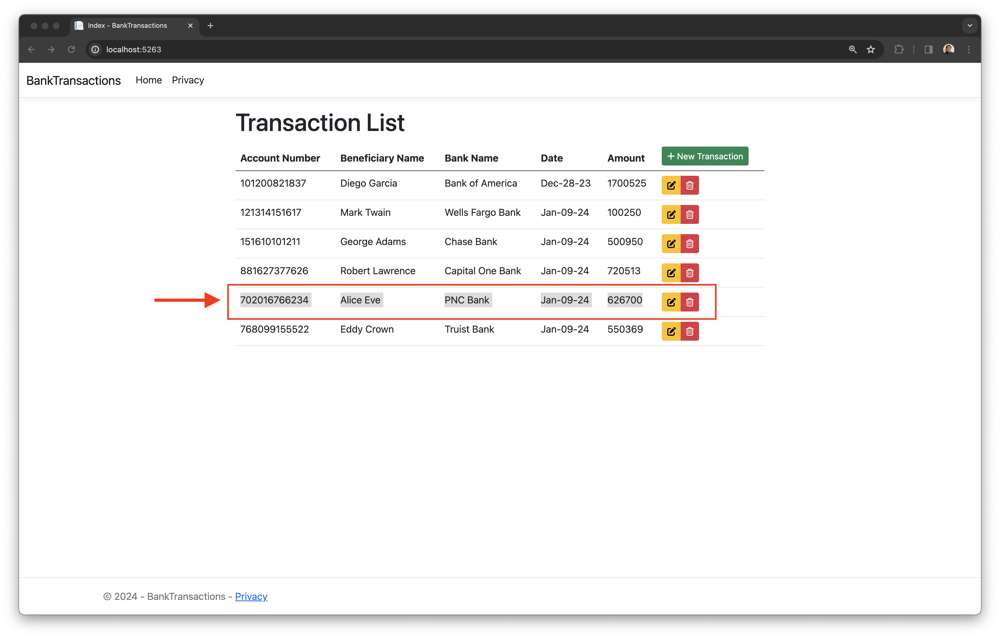

---

## Contents

- [Features](#features)
- [Tech stack](#tech-stack)
- [How it works](#how-it-works)
- [Design decisions](#design-decisions)
- [Security and data integrity](#security-and-data-integrity)
- [Getting started](#getting-started)
- [Project structure](#project-structure)
- [Walkthrough](#walkthrough)
- [Roadmap](#roadmap)

---

## Features

| Feature | What it means for the user | How it's implemented |
|---|---|---|
| **Add a transaction** | Record a new transfer with a single form | `GET`/`POST /Transaction/AddOrEdit`, with the date stamped by the server |
| **View all transactions** | See every transfer in one table | `GET /Transaction/Index` using `ToListAsync()` |
| **Edit a transaction** | Fix a typo in an account number or amount | The same `AddOrEdit` action, which switches to update mode when an ID is present |
| **Delete a transaction** | Remove a record after a confirmation prompt | `POST /Transaction/Delete/{id}`, protected by an anti-forgery token |
| **Input validation** | Mistakes are caught before anything is saved | Data annotations enforced in the browser *and* on the server |

---

## Tech stack

| Layer | Technology | Role |
|---|---|---|
| Language | **C#** (.NET 6) | Application logic |
| Web framework | **ASP.NET Core MVC** | Routing, controllers, Razor views |
| Data access | **Entity Framework Core 6** | ORM: maps C# classes to database tables |
| Database | **Azure SQL Edge** (SQL Server engine) | Persistent storage |
| Infrastructure | **Docker** | Runs the database in an isolated container |
| UI | **Bootstrap**, **Font Awesome**, **jQuery Validation** | Responsive layout, icons, instant form feedback |
| Tooling | Visual Studio, Azure Data Studio | Development and database inspection |

---

## How it works

```
 Browser                ASP.NET Core MVC                    Docker
┌──────────┐  HTTP   ┌──────────────────────────┐  EF Core  ┌──────────────────┐
│ Razor    │ ──────▶ │ TransactionController    │ ────────▶ │ Azure SQL Edge   │
│ views +  │         │  • Index      (GET)      │           │ (SQL Server)     │
│ Bootstrap│ ◀────── │  • AddOrEdit  (GET/POST) │ ◀──────── │  Transactions    │
└──────────┘  HTML   │  • Delete     (POST)     │   async   │  table           │
                     └──────────────────────────┘           └──────────────────┘
```

1. **The user opens a page.** The browser asks the server for the transaction list.
2. **The controller handles it.** `TransactionController` asks Entity Framework for the data.
3. **Entity Framework talks to the database.** It turns C# calls like `ToListAsync()` into SQL queries, so no SQL is written by hand.
4. **The view renders the result.** A Razor view turns the data into an HTML table styled with Bootstrap.

### The data model

One entity, `Transaction`, defines both the C# object and the database table:

| Field | Type | Rules |
|---|---|---|
| `TransactionId` | `int` | Primary key, auto-incremented |
| `AccountNumber` | `nvarchar(12)` | Required, max 12 characters |
| `BeneficiaryName` | `nvarchar(100)` | Required |
| `BankName` | `nvarchar(100)` | Required |
| `SWIFTCode` | `nvarchar(11)` | Required, max 11 characters (the SWIFT/BIC standard length) |
| `Amount` | `int` | Required |
| `Date` | `datetime2` | Set by the server when the record is created |

---

## Design decisions

**Code-first with EF Core migrations.**
The schema is defined in C# (`Models/Transaction.cs`), and the table is generated from that by the `InitialCreate` migration. Schema changes are versioned in source control alongside the code, so any developer can rebuild the exact same database with one command.

**A single `AddOrEdit` action instead of separate Create and Edit actions.**
A transaction ID of `0` means "new" and any other ID means "update." This halves the number of views and actions while keeping the behavior explicit.

**Dependency injection for the database context.**
`TransactionDbContext` is registered in `Program.cs` and injected into the controller's constructor. The controller never creates its own database connection, which keeps it loosely coupled and makes it straightforward to swap in an in-memory database for tests.

**Async all the way down.**
Database calls use `ToListAsync`, `FindAsync` and `SaveChangesAsync`, so a request waiting on the database doesn't block a server thread.

**Database in Docker.**
Azure SQL Edge runs the SQL Server engine in a lightweight container that works on both Intel and Apple Silicon machines. No local SQL Server installation is needed.

---

## Security and data integrity

| Protection | Threat it addresses | Where |
|---|---|---|
| `[ValidateAntiForgeryToken]` on every `POST` | **CSRF**: another site tricking a logged-in user's browser into submitting a form | `TransactionController` |
| `[Bind(...)]` allow-list | **Overposting**: an attacker adding unexpected fields to a request | `AddOrEdit` POST |
| Server-side `ModelState.IsValid` check | Bypassing browser validation with a crafted request | `AddOrEdit` POST |
| Client-side jQuery Validation | Bad input reaching the server at all; gives instant feedback | `_ValidationScriptsPartial` |
| Column types and lengths in the schema | Invalid data being stored even if app checks are skipped | EF migration → SQL table |
| Delete confirmation prompt | Accidental deletion | `Index.cshtml` |

---

## Getting started

### Prerequisites

- [.NET 6 SDK](https://dotnet.microsoft.com/download/dotnet/6.0)
- [Docker Desktop](https://www.docker.com/products/docker-desktop/)
- EF Core CLI: `dotnet tool install --global dotnet-ef`

### 1. Start the database

```bash
export SA_PASSWORD='<choose-a-strong-password>'

docker run --cap-add SYS_PTRACE \
  -e 'ACCEPT_EULA=1' \
  -e "MSSQL_SA_PASSWORD=$SA_PASSWORD" \
  -p 1433:1433 --name azuresqledge \
  -d mcr.microsoft.com/azure-sql-edge
```

### 2. Configure the connection string

The app reads a connection string named `DevConnection`. Store it with [user secrets](https://learn.microsoft.com/aspnet/core/security/app-secrets) so the password never ends up in source control:

```bash
cd BankTransactions
dotnet user-secrets init
dotnet user-secrets set "ConnectionStrings:DevConnection" \
  "Server=localhost,1433;Database=TransactionDB;User Id=sa;Password=$SA_PASSWORD;TrustServerCertificate=True"
```

### 3. Create the database and run the app

```bash
dotnet ef database update   # applies the InitialCreate migration
dotnet run
```

Then open **http://localhost:5263**.

---

## Project structure

```
BankTransactions/
├── Controllers/
│   └── TransactionController.cs   # CRUD actions (async, DI, CSRF-protected)
├── Models/
│   ├── Transaction.cs             # Entity + validation rules (data annotations)
│   └── TransactionDbContext.cs    # EF Core database context
├── Migrations/                    # Versioned schema history (code-first)
├── Views/
│   ├── Transaction/
│   │   ├── Index.cshtml           # Transaction list
│   │   └── AddOrEdit.cshtml       # Shared create/edit form
│   └── Shared/                    # Layout and validation scripts
├── wwwroot/                       # CSS, JS, Bootstrap, jQuery
└── Program.cs                     # Service registration and request pipeline
```

---

## Walkthrough

<details>
<summary><b>Setup: database running in Docker</b></summary>

Azure SQL Edge running in a Docker container:
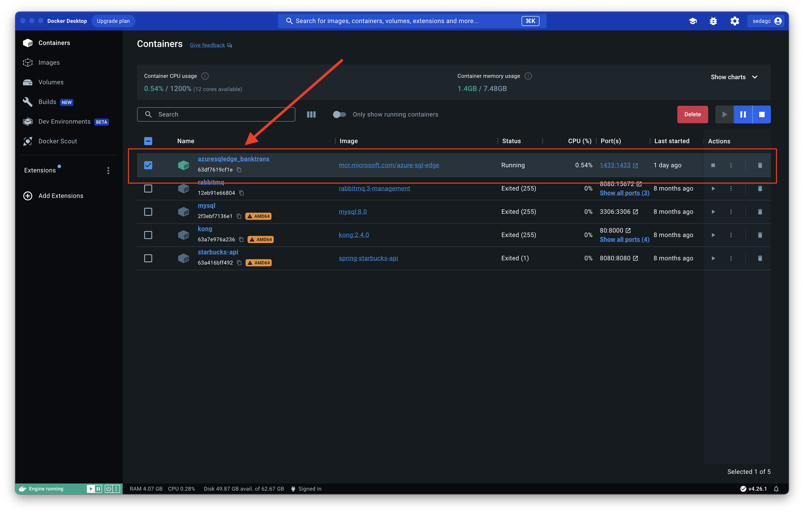

The `Transactions` database viewed in Azure Data Studio:
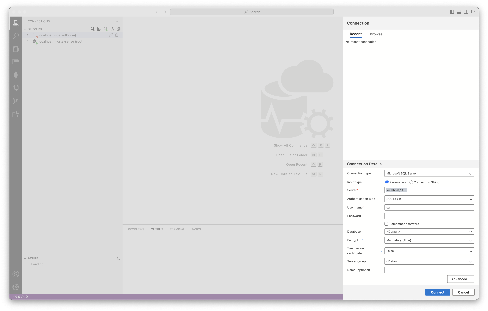
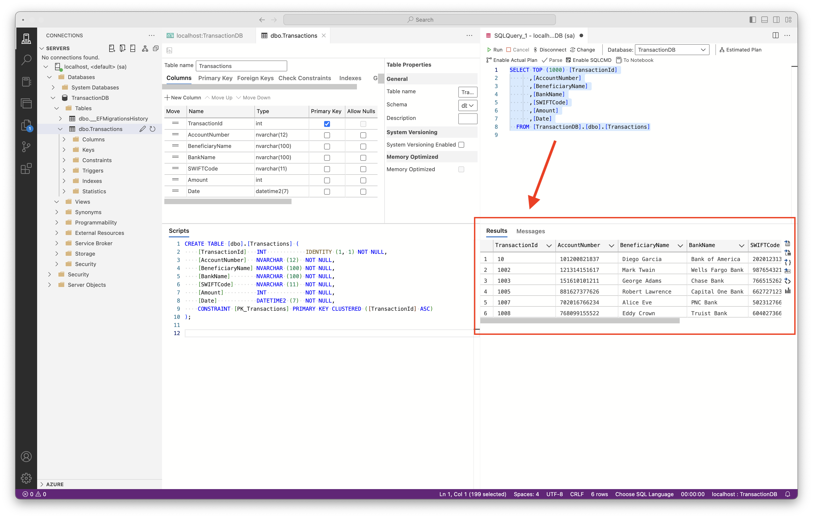

Project structure, with `TransactionController.cs` handling all CRUD operations:
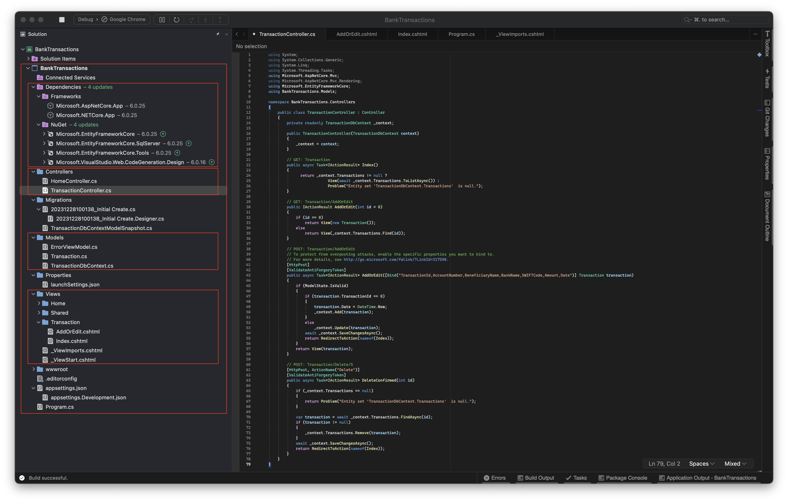
</details>

<details>
<summary><b>Edit a transaction</b></summary>

1. The transaction list.
   
2. Clicking **Edit** opens the form pre-filled with the record.
   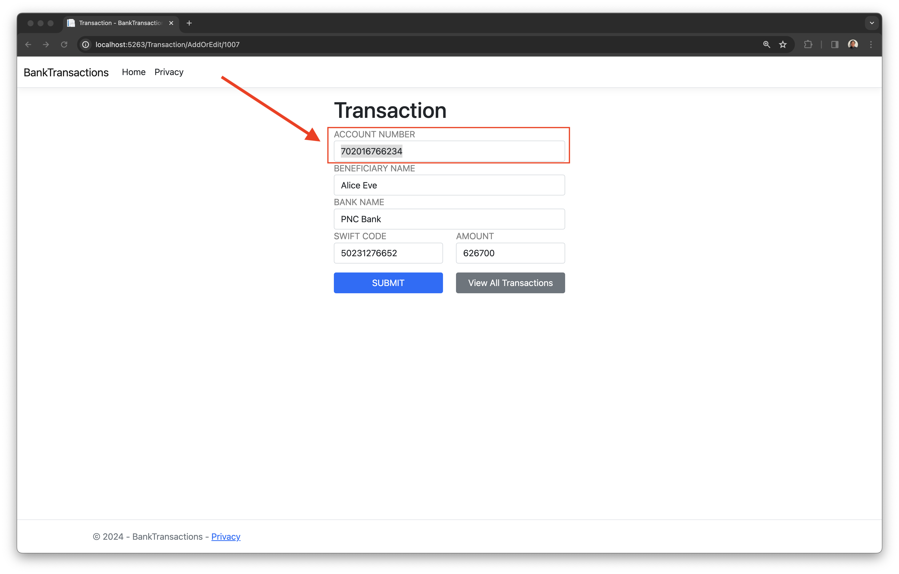
3. Updating the account number and submitting.
   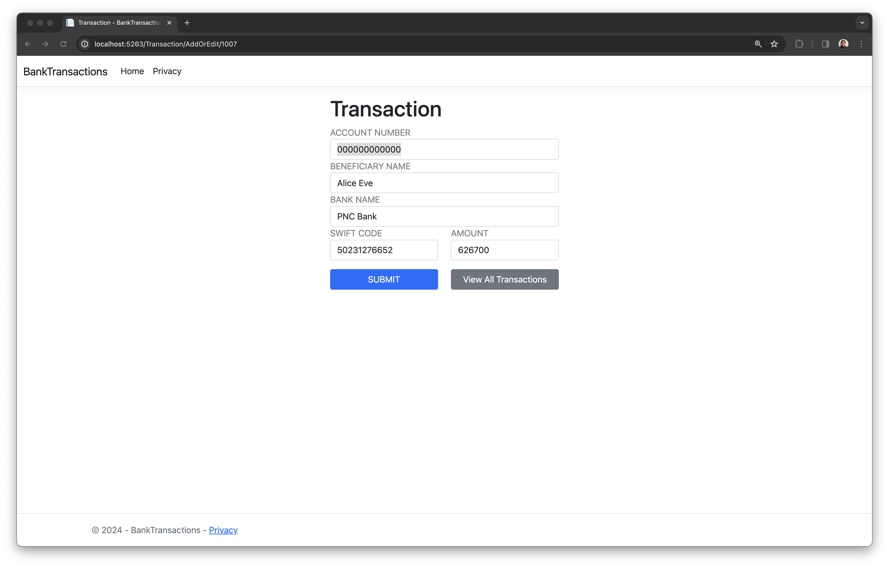
4. The list shows the updated value.
   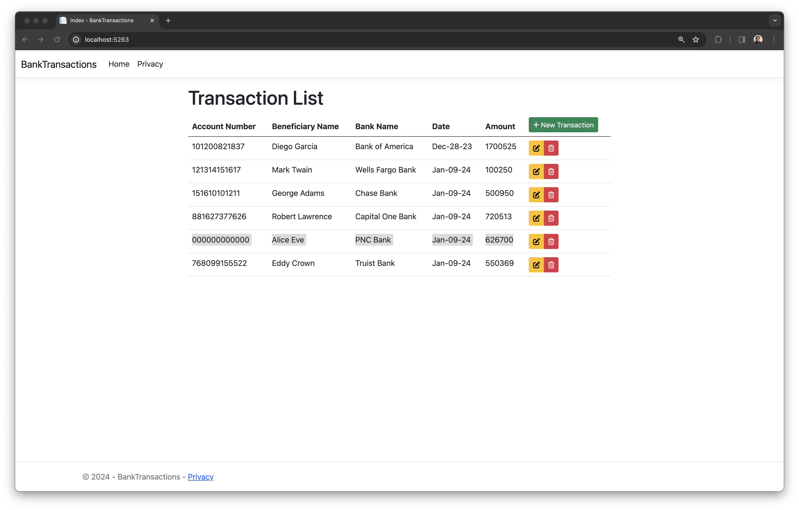
</details>

<details>
<summary><b>Add a transaction</b></summary>

1. Clicking **New Transaction**.
   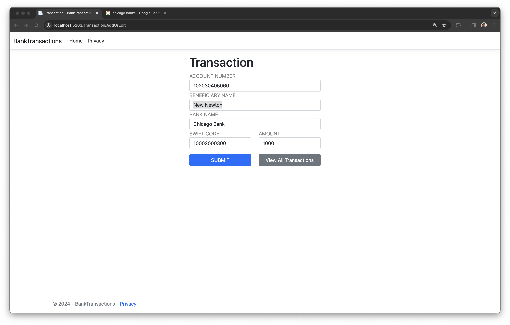
2. The empty form, ready for input.
   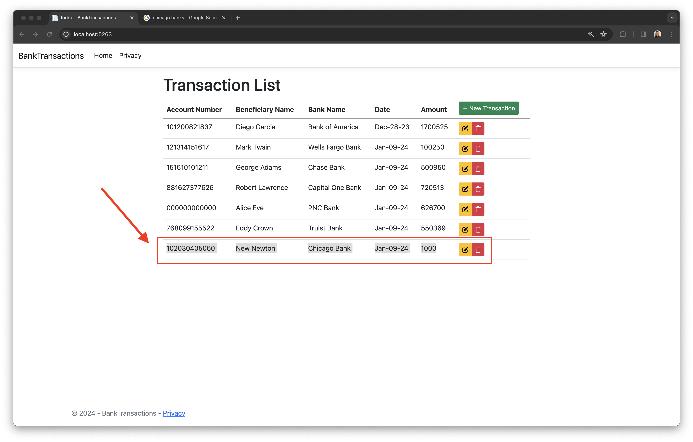
3. The new transaction appears in the list.
   
4. The record is confirmed in the database.
   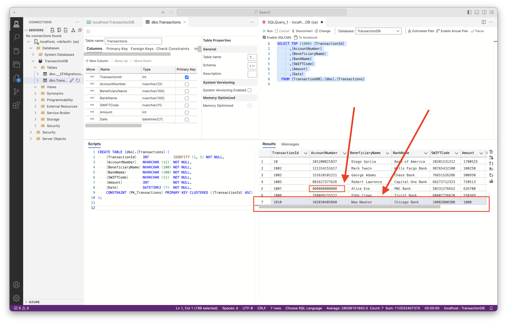
</details>

<details>
<summary><b>Delete a transaction</b></summary>

1. Clicking **Delete** on a row.
   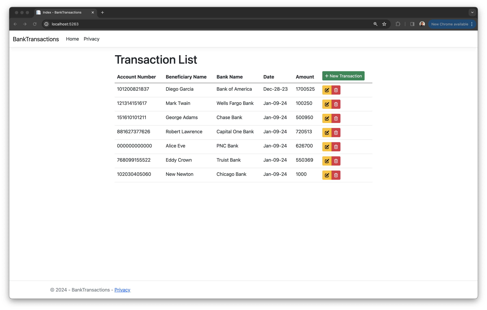
2. Confirming the prompt.
   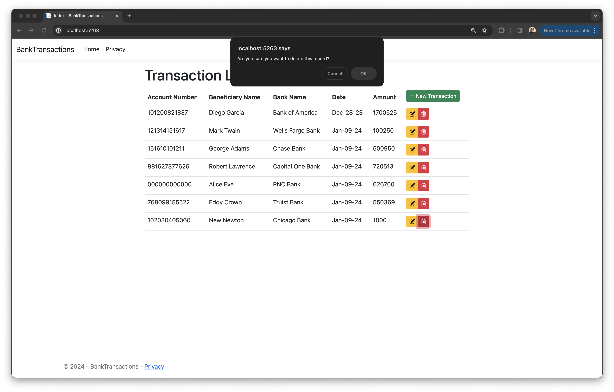
3. The row is gone from the list.
   
4. The deletion is confirmed in the database.
   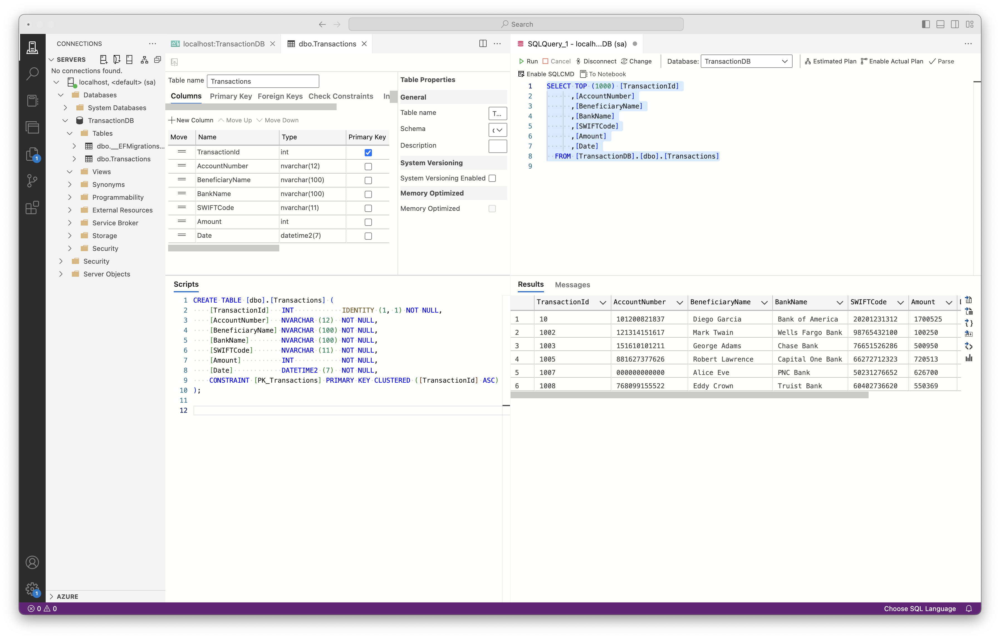
</details>

---

## Roadmap

- [ ] Unit and integration tests with **xUnit** and the EF Core InMemory provider
- [ ] A JSON **REST API** (`/api/transactions`) alongside the MVC views
- [ ] `decimal` amounts instead of `int`, to support cents
- [ ] **Docker Compose** to start the app and database with one command
- [ ] CI pipeline with **GitHub Actions** (build + test on every push)
- [ ] Upgrade to .NET 8 LTS

---

## Resources

- [Azure SQL Edge on Docker Hub](https://hub.docker.com/_/microsoft-azure-sql-edge)
- [EF Core migrations overview](https://learn.microsoft.com/ef/core/managing-schemas/migrations/)
- [Preventing CSRF in ASP.NET Core](https://learn.microsoft.com/aspnet/core/security/anti-request-forgery)
